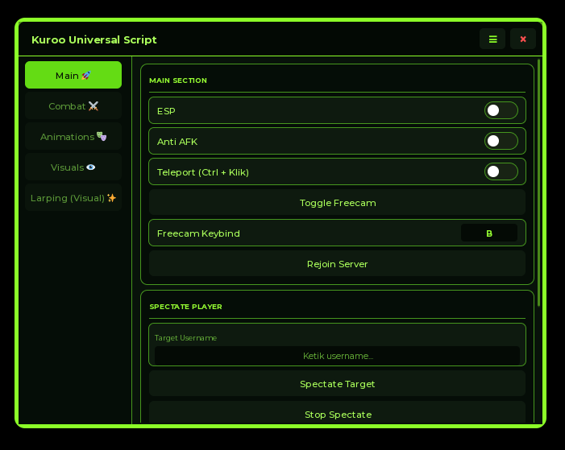
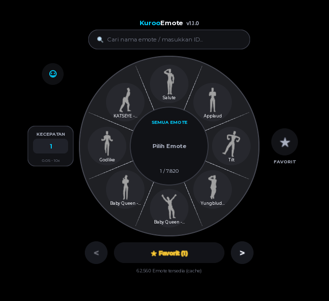

<div align="center">

# 🚀 Kuroo Universal Script + KurooEmote

**Script Universal Roblox All-in-One dengan UI Persona 5 Edition ([KurooUI WindVersion](https://github.com/KurooNeko874/KurooUI_WindVersion)) & Roda Emote 62.000+ Marketplace**

[](https://github.com/KurooNeko874/Universal-Script)
[](https://github.com/KurooNeko874/KurooUI_WindVersion)
[-FFCC33?style=for-the-badge)](https://github.com/KurooNeko874/Universal-Script)
[](#)
[](#)

[](https://www.tiktok.com/@kuro.neko874)
[](#kontak--komunitas--contact)
[](https://github.com/KurooNeko874)

<br/>

🇮🇩 **Bahasa Indonesia** | 🇬🇧 [English Version](#-english-version)

</div>

---

## 📸 Preview / Tangkapan Layar

<div align="center">
  
  <p><i>Tampilan Utama Kuroo Universal Script v1.2.0 (Powered by KurooUI WindVersion — Persona 5 Edition)</i></p>
</div>

<br/>

<div align="center">
  
  <p><i>KurooEmote — Roda Emote 8-Slot dengan 62.000+ Emote Marketplace Roblox</i></p>
</div>

<details>
<summary><b>📱 Lihat Preview Lainnya (Mode Favorit & Tampilan Mobile)</b></summary>
<br/>
<div align="center">
  
  <p><i>Mode Favorit & Pencarian Emote UGC</i></p>
  <br/>
  
  <p><i>Tampilan Responsif Mobile dengan Ikon Bulat Melayang yang Bisa Di-Drag</i></p>
</div>
</details>

---

## ⚡ Cara Menggunakan (Loadstring)

### 1. Paket Lengkap (Universal Script v1.2.0 + KurooEmote)
Salin dan jalankan kode berikut di executor Anda:
```lua
loadstring(game:HttpGet("https://raw.githubusercontent.com/KurooNeko874/Universal-Script/refs/heads/main/KurooUniversalScript.lua"))()
```

### 2. Khusus KurooEmote Saja (Standalone)
Jika hanya ingin menjalankan roda emote Marketplace tanpa menu universal:
```lua
loadstring(game:HttpGet("https://raw.githubusercontent.com/KurooNeko874/Universal-Script/refs/heads/main/KurooEmote.lua"))()
```

---

## ✨ Fitur Utama (`v1.2.0`)

### 🧩 Kuroo Universal Script (`KurooUI WindVersion — Persona 5 Edition`)
Dibangun menggunakan [**KurooUI WindVersion**](https://github.com/KurooNeko874/KurooUI_WindVersion) dengan tampilan baru **Persona 5 (Hitam–Merah–Putih)**, Profile Card + halaman **UI Settings** terintegrasi, **Single-Instance Auto-Cleanup Engine**, serta dukungan penuh **PC & Mobile**:

- **Main** — ESP Universal, Anti-AFK, Click Teleport (`Ctrl + Klik` PC), Freecam PC (`WASD` + **`Q`/`E`** naik-turun seperti Roblox Studio + `Shift` boost + Scroll FOV), dan Rejoin Server.
- **Spectate** — Tab khusus dengan **Live Player List** (foto avatar, DisplayName, `@username`) + **pencarian real-time**; klik kartu player langsung masuk target & tekan Spectate.
- **Sync** — Tab khusus **Sync Emote Player** dengan **Live Player List** & pencarian real-time yang sama.
- **Combat** — Pengaturan WalkSpeed (Jalan / Normal / Lari) dengan mode Hold (`Ctrl`/`Shift`) atau Toggle.
- **Animations** — All Emote (KurooEmote terintegrasi), Auto Apply saat Respawn/Rejoin, dan puluhan preset animasi karakter (Idle, Walk, Run, Jump, Fall, Climb, Swim, SwimIdle).
- **Visuals** — Brightness, Time Set, Weather (Normal, Hujan, Salju), UI Theme Switcher, serta **5 Sky & Shader pilihan**:
  - `Realistic RTX Day`
  - `Classical Sunset Sky`
  - `Pink Sky`
  - `Cloudy Day Sky`
  - `Purple Pink Clouds`
- **Larping (Visual)** — Body Part (Headless Horseman, Korblox Deathspeaker Kanan/Kiri), Item Visual berefek lengkap dengan pengaturan Scale/Posisi/Rotasi, serta Apply ke Player Lain.
- **Server** — Daftar otomatis **Friendlist yang sedang bermain di server lain pada map yang sama** lengkap dengan foto avatar & tombol **Join** 1-klik tanpa keluar map + Copy Server JobId.
- **Auto-Responsive PC & Mobile** — Ikon bulat melayang (*draggable*) untuk Mobile & PC, tombol `⚙` UI Settings khusus PC (ganti keybind buka UI & toggle show/hide ikon bulat tersimpan otomatis), serta auto-cleanup bersih saat di-execute 2×.

### 🎭 KurooEmote (`v1.1.0`)
Roda emote kustom bergaya radial 8-slot yang menggantikan Emote Wheel bawaan Roblox:
- **62.000+ Emote Marketplace Otomatis** — Mengambil seluruh katalog emote Official & UGC secara otomatis dengan cache JSON lokal (`KurooEmote/emotes_catalog_v2.json`).
- **Pencarian Nama & Asset ID** — Cari emote berdasarkan nama (pencarian cerdas & live Marketplace) atau langsung ketik Asset ID.
- **Pengaturan Kecepatan (`0.05x` – `10x`)** — Atur kecepatan animasi emote secara real-time.
- **Sistem Favorit Permanen (`★`)** — Simpan emote favorit otomatis di perangkat masing-masing user (`KurooEmote/favorites.json`).
- **Ramah Mobile & PC** — Tombol navigasi `<` dan `>` besar, serta tombol ikon senyum (`☺`) yang **bisa di-drag bebas**.
- **Auto-Stop Seperti Bawaan Roblox** — Emote otomatis berhenti saat bergerak, melompat, duduk, atau respawn.

---

## 🎮 Kontrol & Pintasan

| Aksi | PC | Mobile |
| :--- | :--- | :--- |
| **Buka / Tutup Universal UI** | Tombol `K` *(bisa diubah di UI Settings `⚙`)* | Tap ikon bulat floating *(bisa di-drag)* |
| **Freecam Gerak & Naik/Turun** | `WASD` + `E` (Naik) / `Q` (Turun) + `Shift` (Boost) | — *(Khusus PC)* |
| **Buka / Tutup Emote Wheel** | Tombol `.` *(Titik)* atau klik ikon `☺` | Tap ikon `☺` *(bisa ditahan & di-drag)* |
| **Ganti Halaman Emote** | Klik `<` / `>` atau Scroll Mouse | Tap tombol `<` / `>` di samping Favorit |
| **Tutup Emote Wheel** | Tombol `ESC` atau `.` | Tap ikon `☺` |

---

## 🇬🇧 English Version

<details>
<summary><b>Click to expand English documentation</b></summary>

### Overview
**Kuroo Universal Script v1.2.0** is an all-in-one Roblox universal utility script powered by [**KurooUI WindVersion (Persona 5 Edition)**](https://github.com/KurooNeko874/KurooUI_WindVersion), bundled with **KurooEmote v1.1.0** — a custom 8-slot radial Emote Wheel featuring **62,000+ Roblox Marketplace emotes** with full **PC & Mobile** support and **No Key System**.

### Quick Start
```lua
-- Full Bundle (Universal Script v1.2.0 + KurooEmote)
loadstring(game:HttpGet("https://raw.githubusercontent.com/KurooNeko874/Universal-Script/refs/heads/main/KurooUniversalScript.lua"))()

-- KurooEmote Standalone Only
loadstring(game:HttpGet("https://raw.githubusercontent.com/KurooNeko874/Universal-Script/refs/heads/main/KurooEmote.lua"))()
```

### Key Features (`v1.2.0`)
- **Persona 5 Edition UI (`KurooUI WindVersion`):** Crisp Black/Red/White aesthetic, custom background + dark scrim, circular draggable open button, Sidebar Profile Card + PC UI Settings page (persistent keybind & floating icon toggle), and Single-Instance Auto-Cleanup Engine on re-execute.
- **8 Organized Tabs:**
  - `Main` — Universal ESP, Anti-AFK, Click Teleport, Studio-style Freecam (`WASD` + `Q`/`E` vertical), Rejoin.
  - `Spectate` & `Sync` — Dedicated tabs with **Live Player Lists** (Avatar + DisplayName + `@username`) and instant real-time search filtering.
  - `Combat` — WalkSpeed controller (Walk / Normal / Sprint, Hold or Toggle mode).
  - `Animations` — Integrated KurooEmote, Auto-Apply on Respawn/Rejoin, and full animation pack presets.
  - `Visuals` — Brightness, Time, Weather, Theme Switcher, and 5 curated Sky/Shader presets (`Realistic RTX Day`, `Classical Sunset Sky`, `Pink Sky`, `Cloudy Day Sky`, `Purple Pink Clouds`).
  - `Larping (Visual)` — Korblox/Headless body parts, visual accessories with live transform sliders, and Apply-to-Player.
  - `Server` — Live Friend Server Browser showing friends playing in other servers of the same map with 1-click **Join** + Copy JobId.

</details>

---

## 📬 Kontak & Komunitas / Contact

Suka dengan script ini? Jangan lupa kasih **⭐ Star** di repository ini dan ikuti update terbaru di:

- **GitHub:** [KurooNeko874](https://github.com/KurooNeko874)
- **TikTok:** [@kuro.neko874](https://www.tiktok.com/@kuro.neko874)
- **Discord:** `kuroneko4411`

---

<div align="center">
  Made with ❤️ by <b>Kuroo</b> • Powered by <a href="https://github.com/KurooNeko874/KurooUI_WindVersion">KurooUI WindVersion</a>
</div>
